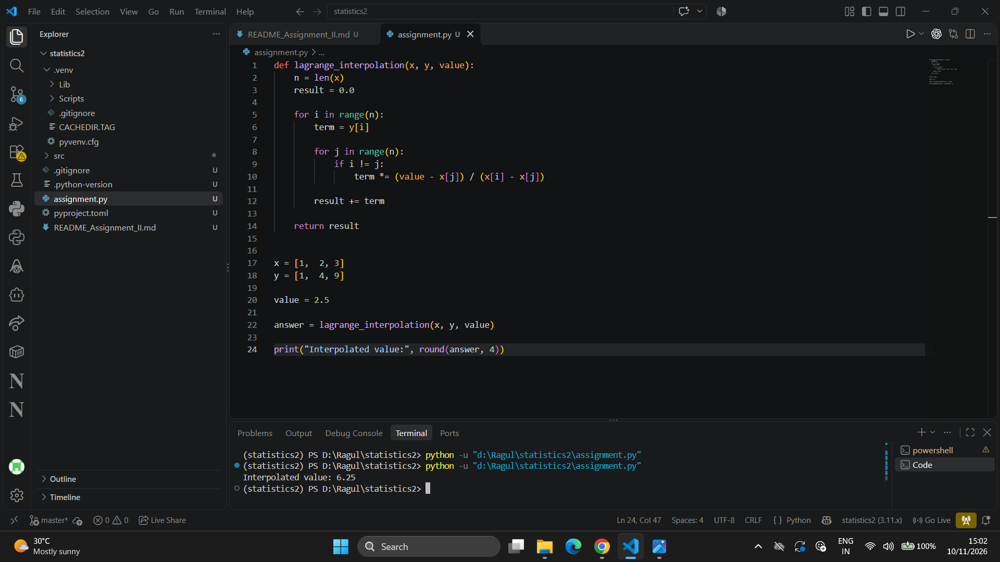
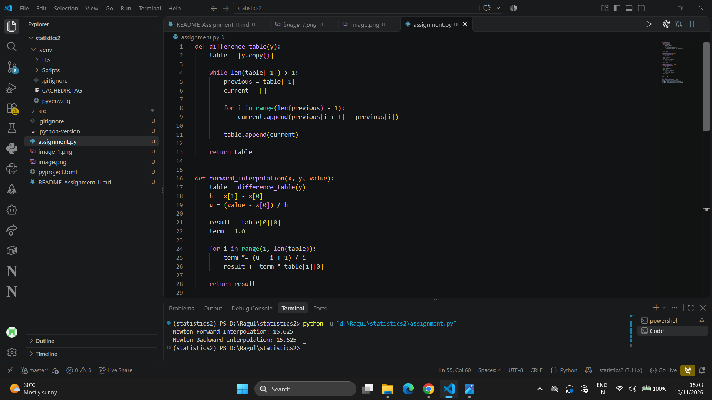
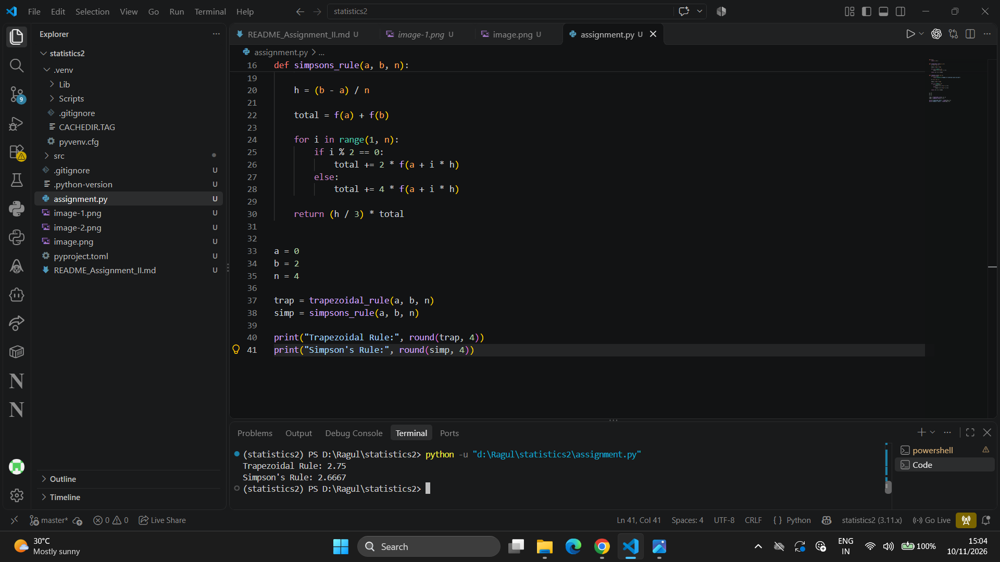
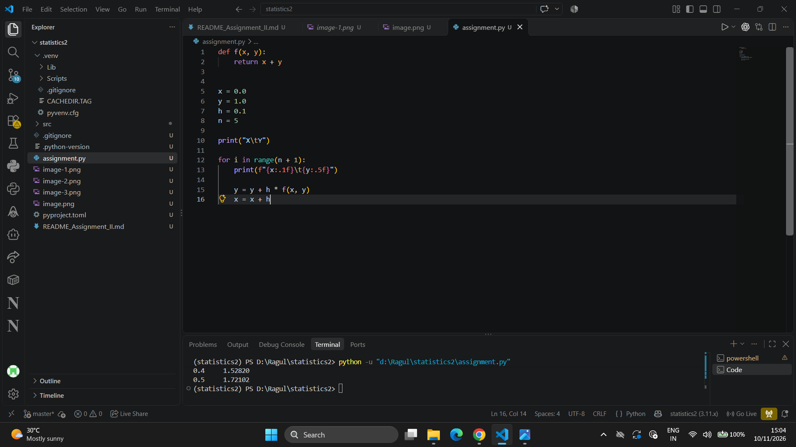
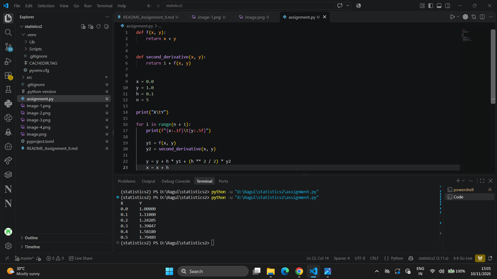
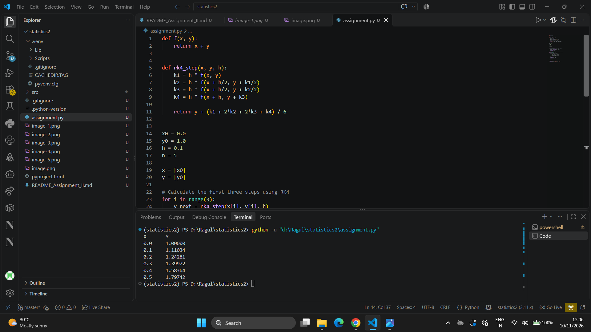

## Experiment 1: Lagrange Interpolation

### Aim
To implement Lagrange Interpolation for estimating the value of a function at a given point using discrete data points.

### Program

```python
def lagrange_interpolation(x, y, value):
    n = len(x)
    result = 0.0

    for i in range(n):
        term = y[i]

        for j in range(n):
            if i != j:
                term *= (value - x[j]) / (x[i] - x[j])

        result += term

    return result


x = [1,  2, 3]
y = [1,  4, 9]

value = 2.5

answer = lagrange_interpolation(x, y, value)

print("Interpolated value:", round(answer, 4))
```

### Output



### Result
Thus, the Lagrange Interpolation method was implemented successfully. The estimated value of the function at x = 2.5 is **6.25**.

---

## Experiment 2: Newton's Forward and Backward Interpolation

### Aim
To implement Newton's Forward and Backward Interpolation methods for estimating the value of a function using equally spaced discrete data points.

### Program

```python
def difference_table(y):
    table = [y.copy()]

    while len(table[-1]) > 1:
        previous = table[-1]
        current = []

        for i in range(len(previous) - 1):
            current.append(previous[i + 1] - previous[i])

        table.append(current)

    return table


def forward_interpolation(x, y, value):
    table = difference_table(y)
    h = x[1] - x[0]
    u = (value - x[0]) / h

    result = table[0][0]
    term = 1.0

    for i in range(1, len(table)):
        term *= (u - i + 1) / i
        result += term * table[i][0]

    return result


def backward_interpolation(x, y, value):
    table = difference_table(y)
    h = x[1] - x[0]
    p = (value - x[-1]) / h

    result = table[0][-1]
    term = 1.0

    for i in range(1, len(table)):
        term *= (p + i - 1) / i
        result += term * table[i][-1]

    return result


x = [1, 2, 3, 4]
y = [1, 8, 27, 64]

value = 2.5

forward = forward_interpolation(x, y, value)
backward = backward_interpolation(x, y, value)

print("Newton Forward Interpolation:", round(forward, 4))
print("Newton Backward Interpolation:", round(backward, 4))
```

### Output



### Result
Thus, Newton's Forward and Backward Interpolation methods were implemented successfully. Both methods estimate the function value at x = 2.5 as **15.625**.

---

## Experiment 3: Trapezoidal Rule and Simpson's Rule

### Aim
To implement the Trapezoidal Rule and Simpson's 1/3 Rule for numerical integration of a given function.

### Program

```python
def f(x):
    return x ** 2


def trapezoidal_rule(a, b, n):
    h = (b - a) / n

    total = f(a) + f(b)

    for i in range(1, n):
        total += 2 * f(a + i * h)

    return (h / 2) * total


def simpsons_rule(a, b, n):
    if n % 2 != 0:
        raise ValueError("Number of intervals must be even")

    h = (b - a) / n

    total = f(a) + f(b)

    for i in range(1, n):
        if i % 2 == 0:
            total += 2 * f(a + i * h)
        else:
            total += 4 * f(a + i * h)

    return (h / 3) * total


a = 0
b = 2
n = 4

trap = trapezoidal_rule(a, b, n)
simp = simpsons_rule(a, b, n)

print("Trapezoidal Rule:", round(trap, 4))
print("Simpson's Rule:", round(simp, 4))
```

### Output



### Result
Thus, the Trapezoidal Rule and Simpson's 1/3 Rule were implemented successfully to approximate the definite integral of f(x) = x² from 0 to 2.

---

## Experiment 4: Euler's Method

### Aim
To implement Euler's Method for solving a first-order differential equation numerically using an initial value, step size, and number of steps.

### Program

```python
def f(x, y):
    return x + y


x = 0.0
y = 1.0
h = 0.1
n = 5

print("X\tY")

for i in range(n + 1):
    print(f"{x:.1f}\t{y:.5f}")

    y = y + h * f(x, y)
    x = x + h
```

### Output



### Result
Thus, Euler's Method was implemented successfully to obtain the approximate numerical solution of the differential equation dy/dx = x + y with initial condition y(0) = 1.

---

## Experiment 5: Taylor's Method (Second-Order Approximation)

### Aim
To implement Taylor's Second-Order Method for solving a first-order differential equation numerically.

### Program

```python
def f(x, y):
    return x + y


def second_derivative(x, y):
    return 1 + f(x, y)


x = 0.0
y = 1.0
h = 0.1
n = 5

print("X\tY")

for i in range(n + 1):
    print(f"{x:.1f}\t{y:.5f}")

    y1 = f(x, y)
    y2 = second_derivative(x, y)

    y = y + h * y1 + (h ** 2 / 2) * y2
    x = x + h
```

### Output

```text
X       Y
0.0     1.00000
0.1     1.11000
0.2     1.24205
0.3     1.39847
0.4     1.58180
0.5     1.79489
```

### Result
Thus, Taylor's Second-Order Method was implemented successfully to find the approximate solution of the given first-order differential equation.

---

## Experiment 6: Runge-Kutta Method (RK4)

### Aim
To implement the Fourth-Order Runge-Kutta Method for solving a first-order differential equation numerically.

### Program

```python
def f(x, y):
    return x + y


x = 0.0
y = 1.0
h = 0.1
n = 5

print("X\tY")

for i in range(n + 1):
    print(f"{x:.1f}\t{y:.5f}")

    k1 = h * f(x, y)
    k2 = h * f(x + h / 2, y + k1 / 2)
    k3 = h * f(x + h / 2, y + k2 / 2)
    k4 = h * f(x + h, y + k3)

    y = y + (k1 + 2*k2 + 2*k3 + k4) / 6
    x = x + h
```

### Output


### Result
Thus, the Fourth-Order Runge-Kutta Method was implemented successfully to calculate the approximate solution of the given differential equation.

---

## Experiment 7: Adams-Bashforth Method

### Aim
To implement the Adams-Bashforth Method for solving a first-order differential equation numerically using previously calculated values.

### Program

```python
def f(x, y):
    return x + y


def rk4_step(x, y, h):
    k1 = h * f(x, y)
    k2 = h * f(x + h/2, y + k1/2)
    k3 = h * f(x + h/2, y + k2/2)
    k4 = h * f(x + h, y + k3)

    return y + (k1 + 2*k2 + 2*k3 + k4) / 6


x0 = 0.0
y0 = 1.0
h = 0.1
n = 5

x = [x0]
y = [y0]

# Calculate the first three steps using RK4
for i in range(3):
    y_next = rk4_step(x[i], y[i], h)
    x.append(x[i] + h)
    y.append(y_next)

# Apply the four-step Adams-Bashforth formula
for i in range(3, n):
    y_next = y[i] + (h / 24) * (
        55 * f(x[i], y[i])
        - 59 * f(x[i-1], y[i-1])
        + 37 * f(x[i-2], y[i-2])
        - 9 * f(x[i-3], y[i-3])
    )

    x.append(x[i] + h)
    y.append(y_next)


print("X\tY")

for i in range(n + 1):
    print(f"{x[i]:.1f}\t{y[i]:.5f}")
```

### Output



### Result
Thus, the four-step Adams-Bashforth Method was implemented successfully. The initial values were calculated using RK4, and subsequent values were obtained using the Adams-Bashforth formula.

---

